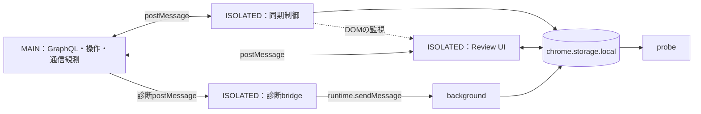

推奨は、**現在の `main/`・`isolated/` 分けを維持し、Biomeの導入と小さな責務分割から進める案**です。大きな問題は命名の不統一よりも、通信フックの重なり、DOMを介した暗黙の連携、同じstorageへの複数箇所からの書き込みにあります。

調査日：2026-11-01。ファイル変更、gitコマンド、パッケージのインストール、Xへの通信は行っていません。`-o` の出力先は会話内にないため、調査結果を全文記載します。この応答からのファイル保存は未実施です。

以下、`M/` は `src/main/`、`I/` は `src/isolated/` を表します。「事実」はソースまたは検査結果、「判断・提案」はそこからの評価です。実際のChrome拡張としての動作確認は行っていません。

**1．ファイルどうしのつながり**

JSは16ファイル、合計3,061行でした。ほかに `probe.html` が43行、`manifest.json` が50行あります。大きい3ファイルでJS全体の約67％を占めます。

| ファイル | 行数 | 現在の責務 |
|---|---:|---|
| `M/graphql-bootstrap.js` | 142 | 共有状態の初期化、BookmarksのqueryId探索、Listsレスポンスの捕捉・補完 |
| `M/page-hook.js` | 119 | fetch・XHRの診断用観測、レスポンス構造の要約 |
| `M/relationship-capture.js` | 68 | fetchレスポンスから被フォロー状態を抽出 |
| `M/graphql-page.js` | 762 | queryId管理、認証ヘッダー捕捉、GraphQL通信、正規化、ページ巡回、同期処理、要求の振り分け |
| `M/graphql-xhr.js` | 70 | XHRからqueryId・認証ヘッダーを捕捉 |
| `M/actions-page.js` | 45 | フォロー解除 |
| `M/cache-control-page.js` | 21 | ページ側queryIdキャッシュの削除 |
| `I/bridge.js` | 37 | 診断観測をbackgroundへ転送 |
| `I/review-ui.js` | 788 | CSS、配置・テーマ、状態、描画、操作、要求送信、画面の取り付け・取り外し |
| `I/graphql-client.js` | 514 | 要求送信、同期順序、storage保存、キャッシュ、先読み、UI状態の監視 |
| `I/ui-metadata.js` | 97 | メタ情報の並べ替え、スクロール位置の補正 |
| `I/relationship-client.js` | 66 | 被フォロー状態をFollowing保存データへ反映 |
| `I/followback-ui.js` | 105 | 描画済みDOMへ被フォロー表示を追加 |
| `I/sync-controls.js` | 127 | 再同期・初期化ボタンの追加、保存データ変更、再読み込み後の再表示 |
| `src/background.js` | 91 | 診断ログ保存、webRequest観測、診断ページを開く |
| `src/probe/probe.js` | 9 | 診断ページ全体の描画・操作。圧縮した書き方で、最長行は1,067文字 |

worldをまたぐ通常の連携は `window.postMessage` です。同じworld内では、共有オブジェクト、DOM、storage変更通知を使っています。



**通信の名前空間・メッセージ型の一覧**

| 識別マーカー／型 | 送受信元 | メッセージ内容 |
|---|---|---|
| `X_FOLLOW_REVIEW_GQL_V1` | `I/graphql-client.js`・`I/review-ui.js` ↔ `M/graphql-page.js` | `request`、`response`、`progress` |
| `X_FOLLOW_REVIEW_ACTION_V1` | `I/review-ui.js` ↔ `M/actions-page.js` | `request`、`response` |
| `X_FOLLOW_REVIEW_CONTROL_V1` | `I/sync-controls.js` → `M/cache-control-page.js` | `request`、`response`。現状、応答を受け取る処理はありません |
| `X_FOLLOW_REVIEW_RELATION_V1` | `M/relationship-capture.js` → `I/relationship-client.js` | `relations`、`items` |
| `X_FOLLOW_REVIEW_PROBE_V1` | `M/page-hook.js` → `I/bridge.js` | `graphql-observation`、`payload` |
| `X_FOLLOW_REVIEW_PROBE_EVENT` | `I/bridge.js` → `background.js` | `chrome.runtime.sendMessage` の `type` |

GraphQLの `action` は、`M/graphql-page.js:740–748` にまとまっています。

- `sync-following`
- `sync-bookmarks`
- `sync-lists`
- `sync-list-index`
- `sync-detail`
- `sync-media`
- `toggle-list`

ほかに `unfollow`、`clear-query-cache` があります。`progress.kind` は `following`、`bookmarks`、`list-index` です。

要求の基本形は `{ marker, type, id, action, payload }`、応答は `{ marker, type, id, ok, result }` または `error` です。要求IDの接頭辞は `xfr-`、`xfr-ui-`、`xfr-control-` に分かれています。

`CustomEvent`、`dispatchEvent`、`chrome.runtime.connect` による連携は見つかりませんでした。`chrome.runtime` のメッセージ通信は診断経路だけで、通常のGraphQL同期をbackground経由で行う構造ではありません。

**MAIN内の共有状態**

`window.__xfrGraphqlShared` を次のファイルが共有します。

- 初期化：`M/graphql-bootstrap.js:6`、`M/graphql-page.js:8`
- 利用：`M/graphql-xhr.js:2`、`M/actions-page.js:3`、`M/cache-control-page.js:13`
- フィールド：`headers`、`queryIds`、`queryTimes`、`lookupCache`

追加の識別子は次のとおりです。

| 識別子 | 用途 |
|---|---|
| `window.__xfrGraphqlXhrInstalled` | XHRフックの二重導入を防ぐ |
| XHRの `this.__xfrGraphqlRequest` | GraphQL用のURL・メソッド・ヘッダー |
| XHRの `this.__xFollowReviewProbe` | 診断用のURL・メソッド |

ISOLATED側には、これに相当する明示的な共有オブジェクトはありません。`bridge.js` だけがIIFEで包まれておらず、`MARKER`、`contextInvalidated`、`handleObservation` がトップレベルにあります。ただし、ほかのファイルがこれらを参照する箇所はありません。トップレベルの `const MARKER` と `window.MARKER` は別物です。

**manifestの読み込み順への依存**

[manifest.json](/C:/Users/pealsha/Documents/codex/mytools/x-follow-review/manifest.json:20) の配列順は次のとおりです。

```text
MAIN:
graphql-bootstrap → page-hook → relationship-capture
→ graphql-page → graphql-xhr → actions-page → cache-control-page

ISOLATED:
bridge → review-ui → graphql-client → ui-metadata
→ relationship-client → followback-ui → sync-controls
```

Chrome公式も、同じ `js` 配列のファイルは記載順に注入すると説明しています。[Chrome公式：content scripts](https://developer.chrome.com/docs/extensions/reference/manifest/content-scripts)

特に注意が必要なのは、MAIN側のフックです。すべて読み込んだ後の `window.fetch` の呼び出し経路は次の形です。

```text
graphql-pageのラッパー
 → relationship-captureのラッパー
 → page-hookのラッパー
 → graphql-bootstrapのラッパー
 → 元のfetch
```

各ファイルは、その時点のfetchを変数へ保存しています。そのため、**順番を変えると、拡張自身のGraphQL通信をどの観測処理が通るかも変わります**。例えば `graphql-page.js:86` の `nativeFetch` は、ブラウザ本来のfetchではなく、先行する3層のラッパーを含みます。

XHRの `open`・`send` も次の2層です。

```text
graphql-xhr → page-hook → 元のXHRメソッド
```

`graphql-xhr.js:17` は共有状態の `headers` をgetter/setterへ置き換えるため、単純な「追加の観測ファイル」以上の役割があります。

ISOLATED側の後付けUIは、ホストDOMを `MutationObserver` で待ち、既存DOMへの取り付けも試すため、同期的な関数呼び出しほど厳密な順序依存ではありません。ただし、`ui-metadata.js` と `followback-ui.js` は同じコンテナのグリッド配置を変更するので、実行順・変更通知の順に影響されます。

また、MAINの初期化には非同期の探索処理があります。manifest上で先に書かれていても、その探索完了まで後続ファイルが待つわけではありません。

**2．命名の実態と、変更時に守る識別子**

基本的な命名は、すでにかなり揃っています。

| 対象 | 現在の型・具体例 | 揺れ・注意点 |
|---|---|---|
| ファイル | kebab-case：`review-ui.js` | `-page`、`-client`、`-capture`、`-hook` の意味が一部曖昧 |
| 変数・関数 | camelCase：`selectedUser`、`hydrateCaches` | 同じ正規化が `canonicalUserKey` と `canonical` |
| 定数 | UPPER_SNAKE_CASE：`HOST_ID`、`QUERY_TTL` | オブジェクトやMapは `KEYS`・`WANTED` と `shared`・`pending` の両方。これは用途の違いとして許容可能 |
| 真偽値 | `isPrivate`、`hasMembershipFlag`、`baseSyncRunning`、`state.open` | 接頭辞は統一されていないが、意味は概ね読める |
| DOM id | `x-follow-review-ui-host`、`detail-help` | メインUIは長い製品接頭辞、probeは短い一般名 |
| DOM class | `xfr-user-row` などのkebab-case | probeは `actions`、`badge`、`danger` など |
| dataset | JSでは `xfrFollowback` | HTML属性では `data-xfr-followback`。これは標準の対応であり、不統一ではない |
| CSS変数 | `--xfr-border-strong` など | 命名形式の揺れはほぼない |
| メッセージ | マーカーは大文字、type/actionは小文字・kebab-case | runtime用typeだけ大文字。通信層の違いとして説明可能 |
| 保存キー | `xFollowReview.<項目>.v1` | 診断キーだけ `xFollowReviewProbe.events` でバージョンなし |
| 外部APIの項目 | `screen_name`、`rest_id`、`followed_by` | Xの形式なので、内部命名へ一律変更しない |

具体的に揃える価値がある箇所は次のとおりです。

- ユーザーキー正規化：`I/graphql-client.js:53` の `canonicalUserKey`、`I/relationship-client.js:8`・`I/followback-ui.js:9` の `canonical`。
- 時間の単位：`SCROLL_PRESERVE_MS` は単位付きですが、`LIST_MEMBER_TTL`、`MEDIA_TTL`、`QUERY_TTL` は単位なし。すべて現在はミリ秒です。
- 同じ対象の呼び方：`listMemberCache`、`listMembersCache`、`memberCache`。それぞれMAINのメモリキャッシュ、ISOLATEDの保存用キャッシュ、メッセージ項目です。単純に同名へ揃えるより、その違いが分かる名前が適しています。
- `nativeFetch`：前述のとおり、実際は「直前のfetch」です。`previousFetch` などの方が実態に近い箇所があります。
- `themeTimer`：`I/review-ui.js:355–360` ではテーマと配置の両方を更新するので、`layoutTimer` などが実態に近いです。
- `xfr-bookmarks-placeholder`：実データのブックマーク一覧にも使われています。`I/review-ui.js:457–487`。`xfr-bookmarks-grid` の方が自然です。
- `probe.js` の `$`、`g`、`n` と圧縮した書き方は、ほかのファイルより読み取り負担が大きくなっています。

**永続保存されるキー：名前を変える場合は移行が必要**

`chrome.storage.local` のキーは以下の10個です。

| キー | 保存内容・主な参照元 |
|---|---|
| `xFollowReview.following.v1` | ユーザー一覧。同期、UI、被フォロー情報更新で共有 |
| `xFollowReview.bookmarksByAuthor.v1` | 著者キー別ブックマーク |
| `xFollowReview.bookmarkMeta.v1` | 最終同期時刻、完全同期時刻、件数 |
| `xFollowReview.lists.v1` | Lists一覧 |
| `xFollowReview.listMemberships.v1` | ユーザーキー別の所属List |
| `xFollowReview.listMembers.v1` | List ID別のメンバーIDと更新時刻 |
| `xFollowReview.listIndexMeta.v1` | インデックスの署名・更新時刻 |
| `xFollowReview.mediaByAuthor.v1` | 著者キー別メディア・更新時刻 |
| `xFollowReview.syncStatus.v1` | 同期メッセージ、段階、更新時刻、transport |
| `xFollowReviewProbe.events` | 診断イベント、最大400件 |

定義箇所は主に `I/graphql-client.js:8–18`、`I/review-ui.js:7–13`、`I/sync-controls.js:5–15`、`background.js:1`、`probe.js:1` です。

ページ側にも次の保存キーがあります。extension storageとは保存先が異なります。

| 保存先 | キー | 内容 |
|---|---|---|
| ページoriginの `localStorage` | `xFollowReview.queryIds.v1` | operation別のqueryId・更新時刻 |
| ページの `sessionStorage` | `xFollowReview.reopenAfterReload.v1` | 再読み込み後にReview Modeを開くための印。値は `force`・`reset` |

根拠：`M/graphql-page.js:92–125`、`M/cache-control-page.js:3–11`、`I/sync-controls.js:4,49,71,100–106`。

キーだけでなく、保存データの `key`・`handle`・`username` の意味、`@`付き小文字の索引、`updatedAt`・`lastFullSyncAt`・`userIds` などのフィールド名も互換性の対象です。**内部変数名の変更と、保存形式の変更は分けて扱うべきです。**

**DOM・通信上の識別子：まとめて変更する必要があるもの**

DOM識別子は永続データではありません。名前を変えても保存データ自体は消えませんが、参照元を更新しないと機能が壊れます。

| 対象 | 現在の識別子 |
|---|---|
| UIホストid | `x-follow-review-ui-host` |
| ファイル間で使う主なclass | `xfr-shell`、`xfr-handle`、`xfr-user-row`、`xfr-list-handle`、`xfr-row-meta`、`xfr-summary`、`xfr-user-list`、`xfr-danger`、`xfr-detail-pane`、`xfr-topbar`、`xfr-toggle`、`xfr-mini-chip`、`xfr-chip` |
| 状態属性 | `data-open`、`data-selected` |
| 後付け処理の属性 | `data-xfr-meta-normalized`、`data-xfr-followback`、`data-xfr-controls`、`data-xfr-control` |
| probeのid | `refresh`、`copy`、`clear`、`status-following`、`status-bookmarks`、`status-media`、`status-lists`、`count`、`rows`、`detail-help`、`detail` |
| 通信識別子 | 前掲の5マーカー、runtime用type、各action・kind、共有状態のプロパティ名 |

CSS変数は次の11個で、定義・利用とも `review-ui.js` 内にあります。

```text
--xfr-scheme  --xfr-bg       --xfr-elevated
--xfr-fg      --xfr-muted    --xfr-border
--xfr-border-strong          --xfr-subtle
--xfr-hover   --xfr-selected --xfr-scroll
```

加えて、**表示テキストも事実上の識別子になっています**。

- `Review Mode`：`I/graphql-client.js:436` がクリック対象を判定。
- `通常表示`：`I/sync-controls.js:95` がボタン挿入位置を判定。
- `★`・`ブックマーク`・`リスト`：`I/ui-metadata.js:14–15` が表示順の対象を判定。

これらは、ラベル変更だけで別機能が動かなくなる原因になります。

X側の `data-testid` である `primaryColumn`、`UserCell`、`AppTabBar_Home_Link` や、GraphQL operation・feature名も外部との接点です。こちらの命名規約に合わせる対象ではありません。

**3．構造上の問題と分割の境目**

**`review-ui.js` は、まずCSSと表示環境への適応を分けやすいです。**

| 現在の範囲 | 責務 | 分割候補 |
|---|---|---|
| 36–262 | CSS文字列 | `review-styles.js`。最初は現在のShadow DOMへの挿入方式を維持 |
| 264–361 | ルート判定、X画面の位置検出、配置、テーマ | `review-layout.js` |
| 363–487、547–718 | DOM部品、一覧・詳細・全体の描画 | 小規模案では現ファイルへ残す。踏み込む場合は一覧・詳細を分離 |
| 385–433、720–723、770–773 | DOMからの初期値、保存データ読込、状態更新 | 状態・storage担当へ |
| 490–545、758–768 | 要求管理、List変更、フォロー解除 | transportと操作担当へ |
| 725–788 | mount/unmount、SPA遷移、イベント登録 | エントリーポイントへ |

788行のうち、CSSが227行です。JSの行数だけを見て、最初から描画関数を細かく分割する必要はありません。

CSSを外部ファイルへ移す場合、manifestの `css` 指定だけではShadow DOM内部への適用を置き換えられません。読み込み方式や公開リソース指定も検討が必要なので、最初は「CSS文字列を別JSへ分ける」方が変更を限定できます。

**`graphql-page.js` は、通信・解析・業務処理の3境界が自然です。**

| 現在の範囲 | 責務 | 分割候補 |
|---|---|---|
| 2–81 | TTL、queryId fallback、feature設定 | operation設定 |
| 92–245 | queryId保存・探索・期限管理 | queryId registry |
| 147–171、247–318 | ヘッダー捕捉、GET・mutation、再試行 | transport |
| 320–427 | 再帰探索、User/Tweet/List正規化、cursor抽出 | response parser |
| 429–738 | ログインユーザー、ページ巡回、Following/Bookmarks/Lists/Media | 機能別の同期処理 |
| 740–758 | action振り分け、応答 | bridge入口 |

小規模案なら「parserを取り出す」だけでも十分です。queryId管理や通信フックの分割は、呼び出し順の変更を伴いやすく、次の段階に向いています。

**`graphql-client.js` も、将来の追加先としては注意が必要です。**

514行の中に要求・応答、保存の順序制御、キャッシュ、各同期処理、先読み、DOM監視が同居しています。

- `48–68`・`461–482`：要求・応答のtransport
- `70–145`：保存・復元・鮮度判定
- `152–409`：同期と先読み
- `429–459`・`505–513`：画面状態の検出

特に、画面状態をDOMから読み取る部分を分離すると、表示ラベル・class名の変更による影響を追いやすくなります。

**重複・役割の重なり**

| 重複箇所 | 根拠 | 判断 |
|---|---|---|
| storageキーの定義 | `graphql-client`、`review-ui`、`sync-controls`、relationship関連 | ISOLATED内で共有する価値が高い |
| `walk` | `graphql-bootstrap:27`、`graphql-page:320`、`relationship-capture:16` | 同じworld内の共通処理候補 |
| GraphQL URL解析 | background、page-hook、bootstrap、graphql-page、graphql-xhr、relationship-capture | 戻り値や対象が少し異なる。共通化時は差を維持する |
| User抽出 | `graphql-page:328`、`relationship-capture:24` | 共通のUser形式への変換にまとめる候補 |
| List抽出 | `graphql-bootstrap:35`、`graphql-page:388` | fallback側は保持項目が少なく、完全な同一処理ではない |
| 要求ID・pending・timeout | `review-ui:490`、`graphql-client:48` | ISOLATEDの共通transport候補 |
| ホスト発見・Observer登録 | graphql-client、ui-metadata、followback-ui、sync-controls | 後付け処理を統合すると大部分が不要になる |
| スクロール復元 | `review-ui:567–605`、`ui-metadata:41–59` | 2か所で制御しており、所有者を1つにしたい |
| チップ配置 | `review-ui` のCSS、ui-metadata、followback-ui | 描画時点で順序・配置を決める方が明確 |

**未使用・効果がない可能性がある箇所**

確実なものと、動作確認が必要なものを分けます。

- **事実：** `X_FOLLOW_REVIEW_CONTROL_V1` の `response` は送信されますが、受信処理がありません。`I/sync-controls.js:56–72` は応答を待たず、80ms後に再読み込みします。
- **事実：** `xFollowReview.syncStatus.v1` は書き込まれていますが、その内容を表示する処理は見つかりません。`hydrateCaches()` も取得したstatusを利用していません。
- **事実：** `sync-detail` の結果の `user`・`allLists`、`sync-media` の結果の `user` は、現在の呼び出し元で利用されていません。`progress` の `completed`・`total`・`cacheHit` なども、現在の同期側コールバックでは使われていません。
- **事実：** `probe.html` にはCSSファイルやstyle要素がありません。`actions`、`badge`、`danger`、JSが切り替える `ok` などのclassに対応する装飾は、このリポジトリ内では機能していません。
- **推論・未確認：** `graphql-bootstrap.js:77–101` のLists補完は、MAIN側の `window.postMessage` を差し替えてrequestを記録する仕組みです。しかしrequestの送信元はISOLATED側です。worldごとにJS環境が分離されるため、MAINの差し替えでISOLATED側の送信を捕捉する前提には問題があり、`actionsById` が埋まらず補完が働かない可能性があります。実ブラウザでの確認が必要です。[Chrome公式：worldの分離](https://developer.chrome.com/docs/extensions/develop/concepts/content-scripts)
- **推論・未確認：** `followback-ui.js:53` は、描画済みチップへ毎回 `textContent` を設定します。一方、同ファイルのObserverはその配下の子ノード変更を監視しています。同じ文字列でもノードの置き換えによって再通知され、毎フレームの再処理が続く可能性があります。実際の負荷は測定していません。

既定lintでは未使用変数の指摘はありませんでした。また、`graphql-page.js` の名前付き関数はすべて定義以外の参照がありました。ただし、それだけで各分岐が実際に動いているとは断定できません。

**役割とファイル名のずれ**

- `graphql-bootstrap.js`：初期化だけでなく、ネットワーク探索・Listデータ保持・レスポンス補完まで担当。
- `graphql-client.js`：通信クライアントより、同期全体の制御役。
- `ui-metadata.js`：メタデータそのものより、描画済みDOMとスクロールの補正役。
- `bridge.js`：一般的なbridgeではなく診断専用。`probe-bridge.js` が実態に近いです。
- `actions-page.js`：現在の操作はフォロー解除だけ。
- `cache-control-page.js`：削除対象はqueryIdと一部の共有メモリです。Following等の全キャッシュを扱う名前にも読めます。

**probeとbackgroundは必要か**

**事実として、両方とも現在の役目があります。**

- probe：operation別の最新観測、HTTP状態、レスポンス構造、JSONコピー、履歴消去。
- background：診断画面を開く、観測イベントを保存する、webRequestからヘッダーの有無とHTTP結果を収集する。
- page-hook：backgroundのwebRequestだけでは得られないレスポンス構造を収集する。

通常のReview Modeの同期には診断画面を開く必要がなく、backgroundも通常同期の仲介役ではありません。したがって、**診断機能を残すかどうかという製品上の判断であり、単純な未使用コード削除ではありません**。

削除するなら、backgroundだけでなく `page-hook`、`bridge`、probeページ、manifestのaction/options/background設定、`webRequest` 権限をまとめて検討します。通信フックの連鎖も変わるため、別作業にするのが妥当です。

**4．整形・lintの選択と実測**

ビルドなしでも、開発時だけ整形・lintを使うことはできます。Chromeが読み込むJSを生成し直す必要はありません。

Chrome公式サンプルのリポジトリでは、現在、ESLintとPrettierを使っています。ESLintにはブラウザ・拡張機能・service workerのglobalを指定しています。ただし、多数のサンプルをまとめて扱う設定なので、そのままコピーする必要はありません。[公式サンプルのESLint設定](https://github.com/GoogleChrome/chrome-extensions-samples/blob/main/eslint.config.js)、[整形設定](https://github.com/GoogleChrome/chrome-extensions-samples/blob/main/.prettierrc.json)

| 選択肢 | このリポジトリでの評価 |
|---|---|
| Biome | 整形と基本lintを1つで扱え、現在の規模に適する。第一候補 |
| ESLint＋Prettier | world別のglobal制限や独自の禁止規則を細かく設定しやすい。設定・依存は増える |
| Prettierのみ | 整形は可能だが、要求されているコード検査には不足 |

**結論：Biomeで始めてよいですが、完全な既定設定だけでは不足します。**

不足するのは主に次の点です。

1. 未宣言変数の検査が既定では無効。
2. それを有効にすると `chrome` のglobal指定が必要。
3. 命名規則、保存形式の互換性、manifestの順序、DOM契約は既定lintでは守れない。
4. Chrome APIの引数・戻り値の型や、共有オブジェクトのプロパティ名までは保証しない。

Biome公式でも `noUndeclaredVariables` は推奨ルール外とされ、globalの追加指定が案内されています。[未宣言変数の規則](https://biomejs.dev/linter/rules/no-undeclared-variables/javascript/)、[global設定](https://biomejs.dev/reference/configuration/)

採用時の最小限の追加設定は、例えば次の形です。今回は作成していません。

```json
{
  "linter": {
    "rules": {
      "correctness": {
        "noUndeclaredVariables": "error"
      }
    }
  },
  "overrides": [
    {
      "includes": [
        "src/background.js",
        "src/isolated/**/*.js",
        "src/probe/**/*.js"
      ],
      "javascript": {
        "globals": ["chrome"]
      }
    }
  ]
}
```

`window.__xfrGraphqlShared` は宣言済みの `window` のプロパティなので、未宣言変数の検査ではプロパティ名の誤記を検出できません。またBiomeは、MAINでの拡張API利用禁止やbackgroundでのDOM利用禁止を、この設定だけでは厳密に保証しません。

そこまでworld別に制限したい場合は、ESLintの `languageOptions.globals`、`sourceType: "script"`、必要な禁止規則をファイル範囲別に指定する方が適しています。現在は通常のscriptであり、ES moduleではありません。[ESLint公式：言語・global設定](https://eslint.org/docs/latest/use/configure/language-options)

**今回の実測結果**

既存の別プロジェクトにあった **Biome 2.6.3** を利用しました。新規インストールはしていません。対象はJS16個、HTML1個、manifest1個の計18ファイルです。

| 検査結果 | 件数 |
|---|---:|
| 整形の差 | 17件＝JS全16ファイル＋manifest |
| lintの指摘 | 35件 |
| 合計 | **52件** |
| severityがerror | 36件 |
| severityがwarning | 16件 |
| 検査による変更 | **0ファイル** |

整形の「17件」は差分箇所数ではなく、ファイルごとの診断数です。HTMLには今回、整形診断は出ず、lintの指摘が3件出ました。

| lint規則 | 件数 | 例 |
|---|---:|---|
| `useIterableCallbackReturn` | 13 | `forEach(user => map.set(...))` など |
| `noArguments` | 6 | fetch・XHRラッパーの引数転送 |
| `noPrototypeBuiltins` | 4 | `Object.prototype.hasOwnProperty.call(...)` |
| `useArrowFunction` | 4 | `this` を利用しない関数式 |
| `noAssignInExpressions` | 3 | 共有状態の `||=`、配列初期化とpushの組み合わせ |
| `useButtonType` | 3 | probeのbutton |
| `useOptionalChain` | 1 | backgroundのメッセージ判定 |
| `useDomNodeTextContent` | 1 | DOM初期値取得の `innerText` |

既定設定にはない `noUndeclaredVariables` だけを追加で当てると、**27件すべてが `chrome` の未宣言指摘**でした。既定検査の52件とは別の実験です。

検査に使用した主な指定は次の意味です。

- `check`：整形・lint・補助修正候補を検査。
- `--reporter=json`：集計できるJSON形式で標準出力へ返す。
- `--max-diagnostics=none`：表示件数の上限を外す。
- `--only=correctness/noUndeclaredVariables`：追加実験で、その規則だけを実行。
- 書き換え用の `--write`・`--fix` は指定していません。

検査前後の対象18ファイルのSHA-256はすべて一致しました。JS16ファイルは `node --check` もすべて成功しました。`--check` はJSを実行せず構文だけを確認する指定です。これらの操作によるXへの通信はありません。[Biome CLI](https://biomejs.dev/reference/cli/)

**自動修正を一括適用する前の注意点**

- JS16ファイルはすべてCRLFでした。Biomeの既定はLF・タブ・ダブルクォートなので、初回の整形差は広範囲になります。改行方針を先に決める必要があります。
- `review-ui.js:393` の `innerText` は、表示上の改行を使ってユーザー名やbioを抽出しています。`textContent` への変更は、単なる高速化ではなく抽出結果を変える可能性があります。
- XHRラッパーでは `this` と元メソッドへの引数転送が必要です。`arguments` を直す場合も、可変長の引数をそのまま渡す必要があります。
- JS内のCSS文字列について、JSの整形が通ることと、CSS自体を十分に検査できることは分けて考える必要があります。

**5．公式サンプル・既存拡張との比較**

| 参照例 | 確認した構成・命名 | このリポジトリへの示唆 |
|---|---|---|
| Chrome公式 `tutorial.reading-time` | `manifest.json`、`scripts/content.js`、`images/` | 小さい拡張は浅い構成で十分。固定の大規模構成は不要 |
| Chrome公式 `tutorial.quick-api-reference` | `service-worker.js` から `sw-omnibox.js`・`sw-tips.js` をimport。content側は `content.js` | 役割ごとに分割し、入口を短くする例 |
| Vimium | `background_scripts/`、`content_scripts/`、`lib/`、`pages/`、`icons/`。manifestに複数content scriptを順番に列挙 | ビルドによるbundle化なしでも、world・責務ごとの複数ファイル運用は可能 |

出典：[Reading timeのmanifest](https://github.com/GoogleChrome/chrome-extensions-samples/blob/main/functional-samples/tutorial.reading-time/manifest.json)、[Quick APIのmanifest](https://github.com/GoogleChrome/chrome-extensions-samples/blob/main/functional-samples/tutorial.quick-api-reference/manifest.json)、[Quick APIの入口](https://github.com/GoogleChrome/chrome-extensions-samples/blob/main/functional-samples/tutorial.quick-api-reference/service-worker.js)、[Vimiumのmanifest](https://github.com/philc/vimium/blob/master/manifest.json)。

Vimiumは、Chromeではリポジトリのディレクトリをそのまま読み込む手順を案内しています。一方、テスト・配布等にはDenoの作業スクリプトがあります。「開発用の道具がない」という意味でのビルドなしではありません。ファイル名はsnake_case、JSの関数・プロパティはcamelCase、整形は `deno fmt` です。[Vimiumの開発手順](https://github.com/philc/vimium/blob/master/CONTRIBUTING.md)、[整形設定](https://github.com/philc/vimium/blob/master/deno.json)、[JSの例](https://github.com/philc/vimium/blob/master/lib/utils.js)

これらから、**Chrome拡張共通の唯一のフォルダ構成・命名があるとはいえません**。現在のworld別構成は用途に合っています。公式例に合わせるためだけの全面改名は不要です。

また、service workerがES moduleを使えることと、manifestのcontent script配列をそのままES moduleへ変更できることは別です。今回の分割案では、content scriptは現在の通常script方式を維持する前提です。

**6．整理案の比較**

工数は、現在のコードから見た概算です。既存テストがないため、オフラインでの回帰確認を用意する作業を含みます。X上での確認が必要な項目は、今回未実施です。

|  | 案A：小さく整理 | 案B：連携方法まで整理 |
|---|---|---|
| 方針 | world別構成と既存の連携を保つ | world別構成を保ち、DOM経由の後付け連携を減らす |
| 主な変更 | Biome導入、キー共通化、CSS・parser抽出、紛らわしい内部名の改善 | 案Aに加え、UI・同期・transport・保存の所有者を明確化 |
| 手間の目安 | 2〜4人日程度 | 6〜10人日程度 |
| 動作変更の危険 | 低〜中。初期化順、共有化、整形修正に注意 | 中〜高。描画タイミング、保存順序、キャッシュ挙動が変わり得る |
| 向いている状況 | 近いうちに機能追加したい | 検索・並べ替え・操作・同期機能を継続的に増やす |

**案Aの具体的な範囲**

- Biomeを開発用依存として固定し、整形・基本lint・未宣言変数検査を入れる。
- 改行の扱いを先に固定する。
- `probe.js` を通常の整形へ戻す。
- ISOLATED内のstorageキー・プロトコル定数・ユーザーキー正規化を、少数の共有ファイルへまとめる。
- `review-ui.js` のCSSと `graphql-page.js` のparserを分ける。
- 通信フックの順番、保存キー・保存形式、表示・同期タイミングは維持する。
- 命名変更は内部名を中心にし、外部との識別子は維持する。

分割後の通常scriptは、それぞれIIFEで包み、必要な公開部分だけworldごとの名前空間へ置く方式で足ります。ただし、共有名前空間を導入すること自体が新しい順序依存になるので、manifestの入口と依存順を一緒に検査します。

**案Bの具体的な範囲**

```text
src/
  main/
    entry.js
    capture/
    graphql/
    operations/
  isolated/
    entry.js
    storage/
    sync/
    ui/
  probe/
  background.js
```

この段階では、次の整理が中心です。

- `ui-metadata`・`followback-ui`・`sync-controls` の後付けDOM変更を、UIの描画処理へ統合する。
- 開閉・ユーザー選択を表示テキストやDOMの監視から推測せず、同期側へ明示的に通知する。
- ISOLATEDの要求管理を1つにまとめる。
- Followingなどの保存を1つの担当へ集め、同期・フォロー解除・被フォロー更新の書き込み競合を扱う。
- MAINのfetch・XHRフックを、役割を保って整理する。
- キャッシュの鮮度と、空結果・取得失敗・未取得の違いを明示する。

特に保存担当の統一は、単なるファイル移動ではありません。今はFollowing全体を `graphql-client`、`review-ui`、`relationship-client` がそれぞれ書き換えるため、同時処理の結果を上書きする可能性があります。ここは人工データを使った競合確認が必要です。

最初は案Aを進め、DOM後付け処理に機能追加が集中し始めた段階で案Bへ進むのが妥当です。診断機能の削除は、どちらの案にも必須ではありません。

**7．文書に書くことと、道具で守ること**

| 内容 | 適切な置き場所・守り方 |
|---|---|
| インデント、引用符、空白、改行、折り返し | Biome設定と検査 |
| 未宣言変数、未使用コード、疑わしい構文 | lint |
| ファイル名のkebab-case | 必須にするなら小さな検査。長い文章ルールは不要 |
| manifest内のパスが存在すること | 小さな検査 |
| world別のロード順・依存関係 | 理由を文書へ、破損を検査へ |
| 保存キー・既存データが読めること | 保存仕様とfixtureを使った回帰確認 |
| メッセージの要求・応答・timeout | プロトコル仕様とオフライン検査 |
| DOMのラベルに依存しないこと | 整理後のコードを見本にし、必要なら禁止検査 |
| キャッシュの理由・未取得と空の違い | 文書と振る舞いの検査 |
| 再描画後の選択・検索・スクロール | 操作列を使った回帰確認 |
| フォルダ・関数名の通常例 | 整理後のコードを見本にする |

`AGENTS.md` に短く残す価値が高いのは、コードから理由を読み取りにくい次の事項です。

- MAINとISOLATEDの境界、および通信フックの順番を維持する理由。
- 認証ヘッダー・Cookie本文・CSRF値をstorageや診断出力へ保存しないこと。
- 保存形式を変える場合の移行方針と、空結果で既存値を消す条件。
- 時刻はUnix時刻のミリ秒、期間もミリ秒であること。
- ユーザー索引は `@` 付き小文字、表示用handleとは用途が違うこと。
- キャッシュ表示を先に行うこと、被フォロー表示だけのための個別通信を増やさないこと。
- 失敗を無視してよい処理と、利用者へ知らせる処理の区別。
- 必須の検証コマンドと、動作変更を伴う修正を整形作業へ混ぜないこと。

全キー・メッセージ一覧は `AGENTS.md` へ複写せず、定義コードと `docs/ARCHITECTURE.md` などに集約する方が更新漏れを減らせます。

今回、manifestに記載された対象ファイルの存在とJS構文は確認できました。Biomeの指摘件数も実測済みです。一方、Xとの接続互換性、実画面の操作、指摘したObserverやLists補完の挙動は未確認です。Wikiへの追記は、今回のファイル変更禁止に従い行っていません。